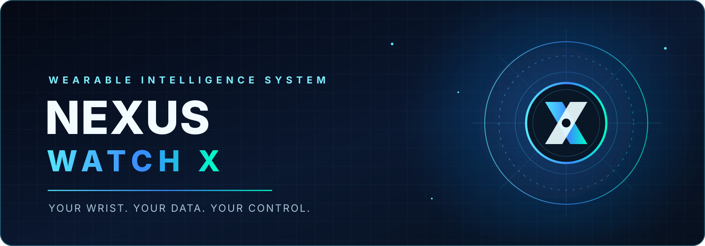

<!-- NEXUS WATCH X | official release channel -->
<p align="center">
  
</p>

<h1 align="center">NEXUS WATCH X · OFFICIAL RELEASES</h1>
<p align="center"><strong>Your wrist. Your data. Your control.</strong></p>
<p align="center">
  <a href="https://github.com/dizir7772/nexus-watch-x-releases/releases/latest"></a>
  <a href="https://github.com/dizir7772/nexus-watch-x-releases/releases"></a>
  
  
</p>

<p align="center">
  <a href="https://github.com/dizir7772/nexus-watch-x-releases/releases/latest"><strong>🚀 GET THE LATEST VERSION</strong></a>
</p>

---

## The NEXUS ecosystem

Two apps. One connected experience.

| App | Designed for | What it does |
|:--|:--|:--|
| **NEXUS WATCH X** | Wear OS watch | Wrist-first dashboard for CORE, HEALTH, GLUCOSE, ANALYTICS and SYSTEM |
| **NEXUS CONTROL** | Android phone | Companion control panel for watch modules, appearance and update checks |

## ⬇ Direct downloads

Always use the latest release assets:

<p align="center">
  <a href="https://github.com/dizir7772/nexus-watch-x-releases/releases/latest/download/nexus-watch-x.apk"><strong>⌚ NEXUS WATCH X · WATCH APK</strong></a>
  &nbsp; · &nbsp;
  <a href="https://github.com/dizir7772/nexus-watch-x-releases/releases/latest/download/nexus-control.apk"><strong>📱 NEXUS CONTROL · PHONE APK</strong></a>
</p>

| File | Install on |
|:--|:--|
| `nexus-watch-x.apk` | Wear OS watch |
| `nexus-control.apk` | Android phone |
| `SHA256SUMS.txt` | Verify downloaded files |

## Install in a few steps

1. Pair the phone and watch through Mobvoi Health / Wear OS first.
2. Download and install **NEXUS WATCH X** on the watch.
3. Download and install **NEXUS CONTROL** on the phone.
4. Open both apps and test the connection and settings sync.

**Important:** Android displays its normal installation confirmation. The updater downloads the APK and opens the system installer; it does not silently install apps.

## Update safely

- Use the in-app **Check for updates** action, or download from [Releases](https://github.com/dizir7772/nexus-watch-x-releases/releases).
- Install updates over the existing app.
- Do not uninstall first unless you intentionally want to reset local app data.
- Every update must carry the same persistent signing certificate as the installed build.

## Integrity

Each release includes `SHA256SUMS.txt`. You can verify an APK on Windows:

```powershell
Get-FileHash .\nexus-watch-x.apk -Algorithm SHA256
Get-FileHash .\nexus-control.apk -Algorithm SHA256
```

Compare the resulting hashes with the matching lines in `SHA256SUMS.txt`.

## Important data principles

- Juggluco remains independent. NEXUS does not intercept or replace it.
- No fabricated glucose or health readings.
- No insulin-dose calculator or treatment recommendations.
- Unavailable measurements must remain visibly unavailable.

## Source code

The application source and build workflows are maintained in a separate repository:

[**dizir7772 / nexus-watch-x**](https://github.com/dizir7772/nexus-watch-x)

The source repository is private at this time. This repository is the public, official APK distribution channel.

---

<p align="center">
  <strong>NEXUS WATCH X</strong><br>
  <sub>BUILT FOR THE WRIST. CONTROLLED BY YOU.</sub>
</p>
